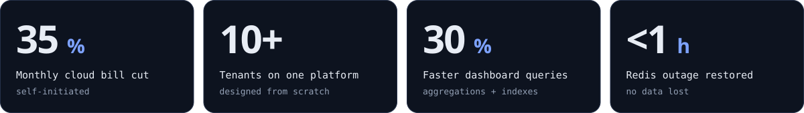
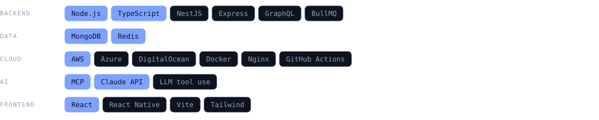

<a href="https://smashysubash.github.io">
  <picture>
    <source media="(prefers-color-scheme: dark)" srcset="assets/banner-dark.svg">
    <source media="(prefers-color-scheme: light)" srcset="assets/banner-light.svg">
    
  </picture>
</a>

  <a href="https://smashysubash.github.io"><b>Portfolio</b></a> ·
  <a href="https://linkedin.com/in/subash07"><b>LinkedIn</b></a> ·
  <a href="https://smashysubash.github.io/resume.pdf"><b>Resume</b></a> ·
  <a href="mailto:smashysubash@gmail.com"><b>smashysubash@gmail.com</b></a> ·
  <a href="https://github.com/subash-vlinder"><b>Work GitHub</b></a> (private repos)

### Numbers from production

<picture>
  <source media="(prefers-color-scheme: dark)" srcset="assets/impact-dark.svg">
  <source media="(prefers-color-scheme: light)" srcset="assets/impact-light.svg">
  
</picture>

### What I build

- **Backend platforms.** A multi-tenant service with a database per tenant, replacing a separate stack for every client. Queues, cron, webhooks, payments with reconciliation, SAP integration.
- **Cloud I own end to end.** AWS, Azure and DigitalOcean: migration, monitoring, security alerts, on-call. Visibility first, then a full audit, which is how the bill came down 35%.
- **AI on top of real data.** A consumer provenance chat grounded in supply-chain records, an agentic data assistant on MCP, and a supply-chain chat that cites its sources and has to pass an eval before release.

Every project has a write-up on the [portfolio](https://smashysubash.github.io/#platform).

### Stack

<picture>
  <source media="(prefers-color-scheme: dark)" srcset="assets/stack-dark.svg">
  <source media="(prefers-color-scheme: light)" srcset="assets/stack-light.svg">
  
</picture>

### On this account

My production work lives in private company repositories ([work GitHub](https://github.com/subash-vlinder)). Here:

- **[BillSync](https://github.com/smashysubash/billsync-app):** vendor PDF invoices into Zoho Books bills. OCR fallback, fuzzy matching that learns, and a human confirms before anything posts.
- **[smashysubash.github.io](https://github.com/smashysubash/smashysubash.github.io):** my portfolio. Astro, three.js, Bun, smoke-tested on every deploy.

The images above are generated by <a href="scripts/build.ts"><code>scripts/build.ts</code></a> in the same design as the portfolio, with light and dark versions.
